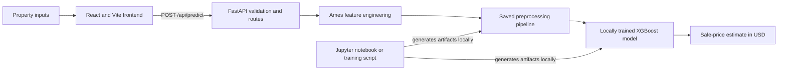

# Estatora

Estatora is a house-price estimation project built around the Ames, Iowa housing dataset. It combines a React form, a FastAPI prediction API, and a trainable XGBoost pipeline to estimate a property's sale price from selected characteristics.

**Live preview:** [Estatora](https://estatora.onrender.com/)

The estimate is an educational prediction, not a real-estate appraisal or financial advice.

## Contents

- [Project overview](#project-overview)
- [Problem and objectives](#problem-and-objectives)
- [Features](#features)
- [Prediction workflow](#prediction-workflow)
- [Dataset and preprocessing](#dataset-and-preprocessing)
- [Feature engineering](#feature-engineering)
- [Model training and evaluation](#model-training-and-evaluation)
- [Technology and architecture](#technology-and-architecture)
- [Repository structure](#repository-structure)
- [Prerequisites](#prerequisites)
- [Setup and running locally](#setup-and-running-locally)
- [Configuration](#configuration)
- [API usage](#api-usage)
- [Tests and build](#tests-and-build)
- [Implementation notes and limitations](#implementation-notes-and-limitations)
- [Security and data licensing](#security-and-data-licensing)
- [License](#license)

## Project overview

The browser collects a focused set of property characteristics and sends them to the API. The backend validates the request, supplies locally learned defaults for omitted features, applies the saved preprocessing pipeline, and returns an estimated sale price in USD.

This is a source-only release: the dataset and trained model artifacts are not included. The API can start without them, but reports degraded health and returns `503` for predictions until a local model has been trained.

## Problem and objectives

House prices depend on property size, quality, condition, location, and other features. Estatora demonstrates an end-to-end regression workflow that transforms a user-friendly subset of property inputs into the model's full feature set, then serves a local XGBoost prediction through an API and browser interface.

The estimate should be treated as a model output for exploration, not a current market valuation or professional advice.

## Features

- React form for common Ames property, quality, size, and sale details.
- FastAPI request validation and JSON prediction responses.
- A committed feature schema that lets the API load without the raw dataset.
- Ames-specific preprocessing and derived features such as total area, bathrooms, porch area, and age at sale.
- Training-split medians and modes for model fields omitted from the form.
- Jupyter notebook for exploration and model comparison, plus a script for training the serving XGBoost model.
- API health, model-information, metrics, and prediction endpoints.

## Prediction workflow

1. A user enters the supported property details in the frontend.
2. The browser sends the values to `POST /api/predict`.
3. Pydantic validates feature types and rejects unknown fields and non-finite numeric values.
4. The service fills omitted features with defaults saved in the local model bundle.
5. The preprocessing pipeline engineers features, imputes values, scales numeric inputs, and encodes categories.
6. The XGBoost regressor predicts in log-price space; the API converts the result back to a USD sale-price estimate.

## Dataset and preprocessing

The project is based on the Ames, Iowa housing dataset. A matching [Kaggle Ames Housing Dataset](https://www.kaggle.com/datasets/prevek18/ames-housing-dataset) is available from the `prevek18` account. Kaggle currently reports the dataset license as **Unknown**. The project does not redistribute the CSV.

The training script expects a CSV containing `SalePrice`, `Order`, and `PID`. Obtain a copy only from a source whose terms permit your intended use, review its license, and place it locally at `backend/data/house-price.csv`. Create that local directory if needed. The notebook and training script remove duplicate rows, clean column values, and split the data into training and holdout sets.

The notebook preserves selected aggregate summaries and plots from an earlier run; it does not retain raw dataset rows. No trained-model inference output is bundled.

For the original dataset context, see Dean De Cock, “Ames, Iowa: Alternative to the Boston Housing Data as an End of Semester Regression Project,” *Journal of Statistics Education*, 19(3), 2011. See the [article and dataset documentation](https://jse.amstat.org/v19n3/decock.pdf).

## Feature engineering

The browser exposes 25 common features. The API schema supports 79 predictor fields from the Ames dataset. The preprocessing pipeline also derives features such as total area, total bathrooms, total porch area, and age at sale. Other omitted inputs use defaults learned from the training split, not hardcoded values.

The `MS SubClass` and `Mo Sold` fields are treated as categorical by the feature transformer. Categorical features are imputed and one-hot encoded; numeric features are imputed and scaled.

## Model training and evaluation

The research notebook in `backend/notebooks/house-price-prediction.ipynb` compares linear regression, random forest, XGBoost, MLP, TabNet, and FT-Transformer models. It selects a model using validation RMSE and reserves the test split for final evaluation.

The serving model is trained by `backend/train_model.py`. It fits an XGBoost regressor to `log1p(SalePrice)` and writes a local model bundle and metadata beneath `backend/models/`. Generated files and metrics are excluded from Git. The model service currently expects this XGBoost bundle; notebook experiments are for research and are not all part of the serving path.

No model artifact or benchmark metrics are included in this release, so no performance claim is made here.

## Technology and architecture

- **Frontend:** React 18, Vite, Tailwind CSS 4, and Lucide React.
- **API:** Python, FastAPI, Pydantic, and Uvicorn.
- **Data and machine learning:** pandas, NumPy, scikit-learn, XGBoost, and Joblib.
- **Exploration:** Jupyter, Matplotlib, Seaborn, and PyTorch.
- **Testing:** pytest and FastAPI TestClient.



The backend separates request schemas, API routes, configuration, and model inference. The frontend calls the API through the configured `VITE_API_URL`.

## Repository structure

```text
Estatora/
├── backend/
│   ├── app/
│   │   ├── api/
│   │   ├── services/
│   │   ├── feature_schema.json
│   │   ├── config.py
│   │   ├── main.py
│   │   └── schemas.py
│   ├── models/                  # Feature-engineering source; generated models are local only
│   ├── notebooks/
│   │   ├── house-price-prediction.ipynb
│   │   └── requirements.txt
│   ├── requirements.txt
│   └── train_model.py
├── frontend/
│   ├── public/
│   ├── src/
│   ├── .env.example
│   ├── package.json
│   └── package-lock.json
├── .gitignore
├── LICENSE
└── README.md
```

The local `backend/data/` directory and generated `backend/models/` artifacts are not part of the repository.

## Prerequisites

- Python 3.11 or newer.
- Node.js 20 or newer and npm.
- Git.

## Setup and running locally

Clone the repository:

```bash
git clone https://github.com/srabonti-codes/estatora-house-price-prediction.git
cd estatora-house-price-prediction
```

### Backend

From `backend/`, create a virtual environment and install dependencies:

```powershell
py -3.11 -m venv .venv
.\.venv\Scripts\Activate.ps1
python -m pip install -r requirements.txt
```

After obtaining an appropriately licensed dataset, create `backend/data/`, save it as `house-price.csv`, and train the serving model:

```powershell
New-Item -ItemType Directory -Force data
python train_model.py
```

Start the API from `backend/`:

```powershell
python -m uvicorn app.main:app --reload --host 127.0.0.1 --port 8000
```

Without a locally generated model bundle, `/api/health` reports a degraded state and prediction requests return `503`.

### Frontend

In another terminal:

```powershell
cd frontend
npm ci
Copy-Item .env.example .env.local
npm run dev
```

Open the Vite URL printed in the terminal. Leave `VITE_API_URL` blank to use the local Vite `/api` proxy; set it to the API origin when using a separate frontend/API origin.

## Configuration

The backend has no credential requirements. `frontend/.env.example` contains the only frontend setting:

| Variable | Purpose | Default |
|---|---|---|
| `VITE_API_URL` | Optional API origin. The value is compiled into browser code and must not contain secrets. | Blank; local requests use the Vite proxy |

Keep local `.env` and `.env.local` files out of Git. The `.gitignore` excludes environment files while allowing `.env.example`.

## API usage

Interactive API documentation is available at `http://localhost:8000/docs`.

| Method | Path | Purpose |
|---|---|---|
| `GET` | `/` | Application name, version, and status |
| `GET`, `HEAD` | `/api/health` | Model and prediction readiness |
| `GET` | `/api/model-info` | Model and target information |
| `GET` | `/api/metrics` | Available model metrics |
| `POST` | `/api/predict` | Estimate a property's sale price |

Example request:

```bash
curl -X POST http://localhost:8000/api/predict \
  -H "Content-Type: application/json" \
  -d '{
    "Neighborhood": "NAmes",
    "Overall Qual": 7,
    "Gr Liv Area": 1500,
    "Lot Area": 5000,
    "Year Built": 1970,
    "Garage Cars": 2
  }'
```

All feature fields are optional; omitted values use defaults saved in the trained bundle. The response includes `predicted_price` and `currency: "USD"`.

## Tests and build

Run the backend tests from `backend/`:

```bash
python -m pytest
```

Build the frontend from `frontend/`:

```bash
npm ci
npm run build
```

The build output is generated under `frontend/dist/` and is not source-controlled.

## Implementation notes and limitations

- The dataset and model are not included. The API starts in a degraded state until the user obtains permitted data and trains a model locally.
- The research notebook explores model families beyond the XGBoost model supported by the serving API.
- The Kaggle listing used as a matching Ames data reference reports its license as Unknown; verify terms before obtaining, using, or redistributing any copy.
- Ames prices represent historical sales in Iowa and do not estimate current market values.
- This project does not implement a user account system, consultations, administrator tools, or role-based permissions.
- No production deployment configuration is included in this source-only repository.

## Security and data licensing

- The API has no authentication and is intended for local, non-sensitive demonstration use. Add appropriate access controls before hosting it for public or private customer data.
- CORS currently allows requests from any browser origin but disables credentialed requests; configure a narrower allowlist before production use.
- Joblib model files use Python pickle serialization. Load only model artifacts from a source you trust.
- The [Kaggle Ames Housing Dataset](https://www.kaggle.com/datasets/prevek18/ames-housing-dataset) reports an Unknown license. This repository excludes the dataset and trained model artifacts; review the data source's terms before creating or redistributing derivatives.
- The root MIT license applies to original Estatora code only, not the dataset or third-party dependencies.

## License

Original project code is provided under the [MIT License](./LICENSE). Dataset terms remain separate and must be checked at the source.
